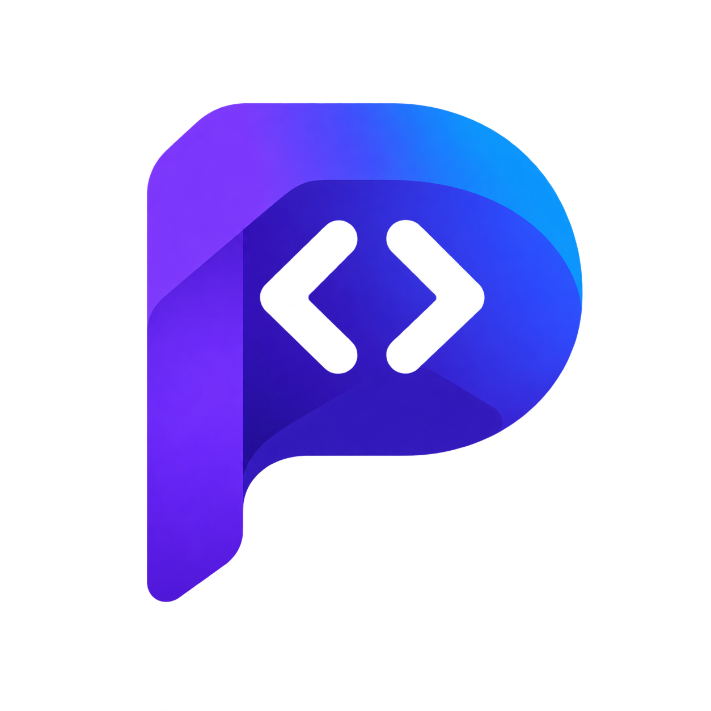

**English** · [Português](README.pt-BR.md)

  

# PHP IDE

An open-source IDE for PHP and Laravel, built with **Rust and Tauri 2** and a **PhpStorm-inspired interface**. The editor, Git, terminal, database, and Docker share the same environment, together with tools for Blade, Vue, and React.

**Available in beta for macOS, Windows, and Linux.**

**[Download PHP IDE](https://github.com/phpforge-dev/php-ide/releases)** · [Website](https://phpforge-dev.github.io/php-ide/) · [Release notes](https://github.com/phpforge-dev/php-ide/releases) · [Plugins](https://github.com/phpforge-dev/plugins) · [Documentation](docs/README.md)

  

  
  

## Features

- **PHP and Laravel:** autocomplete, symbol navigation, find references, and refactorings, with support for Blade and `.env` files.
- **Git:** changes, commits, history, and branches in an integrated panel.
- **Database:** connect to PostgreSQL, MySQL, and MariaDB, browse tables, and run SQL. In Laravel projects, import the connection directly from `.env`.
- **Terminal:** multiple sessions inside the IDE, available with **Alt+F12**.
- **Docker:** containers, logs, and Compose services in the **Alt+8** panel, plus Dockerfile, Compose, and Bash support in the editor.
- **File preview:** view SVG as an image, as code, or both, updating as you edit. Markdown has a preview as well.
- **Vue and React:** built-in support for working on the project frontend.

## Installation

Choose the installer for your system from the **[GitHub releases](https://github.com/phpforge-dev/php-ide/releases)**:

| System | Available packages |
|---|---|
| macOS with Apple Silicon | `.dmg` |
| Windows x64 | `.exe` |
| Linux x64 | `.deb` and `.AppImage` |

After installing, open the IDE and click the project name to choose a folder. Recent projects stay available in that same menu. To use the Docker tools, install Docker and Compose and keep the engine running.

## About the beta

Each release brings improvements and fixes. Some features have limitations, and behavior can vary between systems. See the [release notes](https://github.com/phpforge-dev/php-ide/releases) and the [feature catalog](docs/research/phpstorm-feature-catalog.md) for current support.

Found a problem, or missing something in day-to-day use? [Open an issue](https://github.com/phpforge-dev/php-ide/issues) and describe what happened, including the IDE version and your operating system.

## Join the project

PHP IDE is a project by [Jeidison Farias](https://github.com/jeidison) at [PHP Forge](https://github.com/phpforge-dev). Suggestions, usage reports, and contributions are welcome. To contribute code, see the [development guide](docs/development/contributing.md). To create an extension, see the [plugin tutorial](docs/plugins/getting-started.md).

The project is independent and has no affiliation with JetBrains. A PhpStorm-inspired interface does not imply matching features. The project's own code is distributed under the MIT license; dependencies keep their own [licenses and notices](THIRD_PARTY_NOTICES.md).
