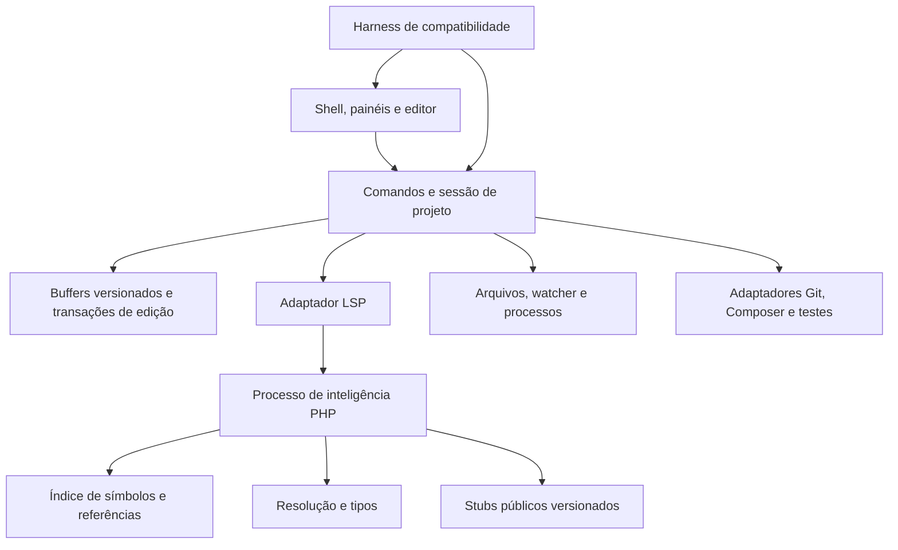

# Arquitetura proposta para a IDE independente

Status: proposta, 21/10/2026. Não é descrição da implementação interna do PhpStorm. Decisão de motor fica condicionada aos ensaios M2; nenhuma dependência foi instalada nesta entrega.

## Corte inicial

Primeiro produto útil: abrir pasta PHP, editar com recuperação de buffers, receber completion contextual, navegar até declaração e voltar. Em seguida, referências e rename com preview/undo. Um shell cheio de botões não atende esse corte.

Proposta inicial: shell desktop com frontend TypeScript e editor Monaco, motor PHP fora da thread da interface e fronteira LSP. Avaliar Tauri e Electron por IME, acessibilidade, atalhos, terminal e distribuição em macOS/Windows antes de fixar o shell. Não acoplar a nova IDE ao aplicativo Meu Hinário.

## Limites e invariantes

| Módulo | Responsabilidade | Contrato relevante |
|---|---|---|
| Workspace | Raízes, exclusões, configuração e vida útil | Troca de projeto cancela requisições e não mistura índices |
| Documentos | Texto, versão, seleção, histórico e arquivos não salvos | Overlay em memória prevalece sobre disco; resposta antiga não altera buffer novo |
| Comandos | IDs estáveis, habilitação, parâmetros, resultado e erro | Menu, atalho e paleta disparam mesma intenção; foco determina contexto |
| Inteligência PHP | Símbolos, tipos, referências, diagnósticos | Resultados explicáveis por arquivo/range e revisão; ambiguidade não vira destino inventado |
| Índice | Descoberta, cache, dependências e invalidação | Fingerprint de arquivo, PHP level, stubs, configuração e versão do motor; cache descartável |
| Edições semânticas | Import, rename e refactor | Preview exato; validar versões/permissões antes de aplicar; undo restaura conjunto de arquivos |
| Host | Watchers, leitura/gravação, PTY e processos | Dono e cancelamento explícitos; recuperação de escrita interrompida |
| Ferramentas | Integrações externas | Versão/runtime/cwd/saída/código de retorno visíveis, sem executar projeto ao indexar |
| UI | Estado e interação | Feedback imediato; indexando, vazio, erro e indisponível são estados distintos |

O [LSP 3.17](https://microsoft.github.io/language-server-protocol/specifications/lsp/3.17/specification/) oferece fronteiras para sincronização, completion, definição, implementação, referências e edições. Suportar esses métodos não garante equivalência semântica: negociar capacidades, codificação de posições, cancelamento e aplicar `WorkspaceEdit` com controle de versão. Um cliente LSP não cria sozinho inferência ou indexação.

## Escolha do motor por evidência

| Candidato | Papel | Avaliação necessária |
|---|---|---|
| [Phpactor](https://github.com/phpactor/phpactor) | Primeiro candidato a servidor PHP reutilizável | Rodar mesmos casos de traits, aliases, PHPDoc e generics; medir consumo e gaps; verificar licença da revisão e transitivas |
| [Tolerant PHP Parser](https://github.com/microsoft/tolerant-php-parser) | Alternativa para experimento de parser próprio | Parsing de código incompleto não é motor de tipos; medir suporte à sintaxe alvo antes de assumir cobertura |
| Motor independente próprio | Alternativa se gaps forem estruturalmente impeditivos | Custo maior: resolver namespaces, hierarquia, PHPDoc, tipos e índice; não começar antes de comparar candidato existente |
| IntelliJ Platform aberta | Alternativa de shell/plataforma | Avaliar peso e extensão; código público da plataforma não inclui automaticamente inteligência PHP proprietária |

Preferência inicial por adaptar um motor aberto, substituível via LSP, e só estender lacunas demonstradas. Registrar versão, licença e conjunto de testes para decidir. Não selecionar um serviço proprietário como requisito obrigatório de uma IDE open source.

## Aprendizados públicos da IntelliJ Platform

[PSI](https://plugins.jetbrains.com/docs/intellij/psi.html) modela estrutura sintática/semântica; [índices e PSI stubs](https://plugins.jetbrains.com/docs/intellij/indexing-and-psi-stubs.html) documentam lookup por arquivos/declarações e trabalho em background. Inspiram separação entre parsing, resolução e cache, além de estados explícitos durante indexação. Não permitem deduzir algoritmos privados de inferência, ranking ou implementação do plugin PHP. Não usaremos as ferramentas internas de inspeção sugeridas pelo SDK sobre o PhpStorm.

**PSI stub e phpstorm-stubs são conceitos diferentes.** O primeiro é uma representação compacta da plataforma; o segundo é um corpus público de assinaturas PHP.

## phpstorm-stubs

Revisão analisada: [`912ae721089fc48534d3a5795997ee8a2802b8cd`](https://github.com/JetBrains/phpstorm-stubs/tree/912ae721089fc48534d3a5795997ee8a2802b8cd). O [README](https://github.com/JetBrains/phpstorm-stubs/blob/912ae721089fc48534d3a5795997ee8a2802b8cd/README.md) descreve assinaturas e PHPDoc para runtime/extensões. A [licença](https://github.com/JetBrains/phpstorm-stubs/blob/912ae721089fc48534d3a5795997ee8a2802b8cd/LICENSE) é Apache-2.0; o README também identifica material do PHP Documentation Group sob CC-BY-3.0. Preservar atribuições aplicáveis e revisar arquivos importados.

Uso proposto: importar fonte pública fixada por SHA em uma etapa controlada, filtrar por PHP/extensões do projeto, tratar como biblioteca de análise e navegar em modo somente leitura. Não executar stubs nem extraí-los da instalação proprietária. Testar disponibilidade/versionamento de símbolos e overrides. O corpus não fornece engine, ranking ou testes de paridade com a IDE; extensões não padronizadas e `@throws` têm limites de validação declarados pelo próprio projeto.

## Ferramentas e dependências por fase

| Fase | Necessárias | Opcionais/depois |
|---|---|---|
| Observação | Trial, UI pública, acessibilidade, fixtures, registro de evidência | Captura de janela com permissão; nenhum REA necessário |
| M2 | Runtime PHP compatível com candidato, Composer em sandbox de testes, cliente LSP de ensaio | Parser alternativo e análise estática complementar |
| Editor | [Monaco](https://github.com/microsoft/monaco-editor), runtime/frontend fixados, host desktop escolhido | Design próprio de ícones e temas, biblioteca licenciada de componentes |
| Ferramentas | Git/Composer, PHPUnit/Pest compatíveis com o projeto | Xdebug com adaptador de protocolo; PTY; adapters Laravel/Symfony |
| Compatibilidade | Runner semântico, UI automation do shell, corpus, snapshots de texto | Benchmarks e capturas visuais locais; CI Windows/macOS |

Node existe no host, mas isso não é validação da versão para qualquer candidato. PHP e Composer ausentes no PATH inicial. Fixar versões e lockfiles no projeto da IDE quando M2 começar. Para debug, documentar tradução entre interface da IDE e protocolo público do Xdebug; LSP não transporta a sessão de debug.

## Riscos e decisões adiadas

Generics/PHPDoc e APIs dinâmicas de frameworks exigirão casos próprios; PHP não deve ser executado para descobrir símbolos por padrão. Rename precisa distinguir referências comprovadas, dinâmicas e texto. Vendor deve ser navegável sem ser alterado incidentalmente. Desempenho e acessibilidade só serão aceitos após medições reais. Temas exigem preview imediato e restauração ao cancelar; atalhos precisam respeitar SO e layouts de teclado. Compatibilidade visual será avaliada por usabilidade, com identidade própria.
